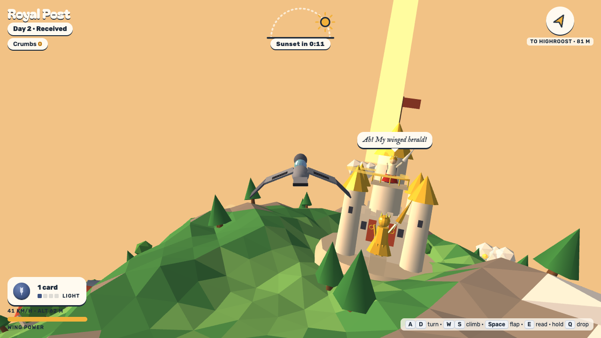

# Royal Post

**You are the royal pigeon.** A florid prince and a terse princess share a planet 1.9 km around and a treaty that says they must marry by the Harvest Moon. They have never met. Every letter between them goes through your claws — and how you carry them decides what kind of marriage they walk into.

**Play it in the browser:** https://stevenli-phoenix-work.itch.io/royal-post

NYU CS-UY 4553 Game Design · Week 5 (two NPCs with distinctive personalities) · idea by V.

## How to play

Six days, one letter a day. Each morning the sender hands you a letter on their balcony; fly it around the little planet to the other royal before the sun sets. The compass and a light beam point the way.

On every letter you get four verbs, and the story bends around them:

- **Deliver on time** — land on the balcony before sunset.
- **Be late** — chase golden bagels, sightsee, arrive after dark. They notice.
- **Peek** — break the seal and read it mid-flight. The sun keeps moving while you read, and the seal stays broken.
- **Lose it** — hold the drop key and let it fall into the sea. The other royal never knows what it said.

There are two endings. Both are weddings.

| Keyboard | Touch | |
|---|---|---|
| `A` `D` | drag to steer | turn |
| `W` `S` | drag up/down | climb / dive |
| `Space` | FLAP | flap hard (uses wing power) |
| `E` | READ | break the seal and read |
| hold `Q` | hold DROP | let go of the letter |
| `Enter` | tap the button | continue |

## The two NPCs

The assignment asks for two NPCs with distinctive personalities. Here the contrast runs through the text, the typography, the 3D models and the **flight physics**:

| | Prince Florian of Highroost | Princess Maren of Westmere |
|---|---|---|
| Voice | Florid, self-moved, lists his titles, compares himself to the sun. Underneath, terrified. | Calm, dry, exactly as many words as needed. Underneath, lonely. |
| Letters | Page after parchment page (up to 14) in IM Fell English with a script salutation, a drop cap and a sun seal | One index card in a typewriter face, signed "— M." |
| Weight | **Heavy**: his letters slow you down and drain your wing power | **Light**: hers barely register |
| Calls you | A new grand name every day | "Pigeon." |
| Home | A gold-roofed castle with banners and a statue of himself | One slim slate tower, a lit window, a vegetable garden, a beehive |

Peeking is the only way to read the letters themselves. Some of them contain lines that were crossed out before sending. The ending card offers the whole correspondence afterwards, but the crossed-out lines in letters you never opened stay blotted.

Full design: [docs/DESIGN.md](docs/DESIGN.md).

## Development

Plain HTML + native ES modules, no bundler. Three.js r128 is vendored in `vendor/`.

```bash
pnpm install
pnpm dev          # http://localhost:5173  (?debug=1 for verbose console logs)
pnpm test         # unit tests: story engine (all 6^6 outcome combinations), letters, terrain, day length, build
pnpm test:e2e     # plays the game in your installed Google Chrome (playwright-core)
pnpm shots        # same, and refreshes docs/*.png (README + itch.io page)
pnpm build        # dist/ — the folder itch.io serves
```

Every push to `main` runs the tests, builds and publishes to itch.io through butler (`.github/workflows/publish-itch.yml`).

## Credits

Idea by V. Flight model and planet from *Pigeon Planet*. Built with three.js. Fonts: Bagel Fat One, Rubik, IM Fell English, Pinyon Script, Special Elite (Google Fonts).
